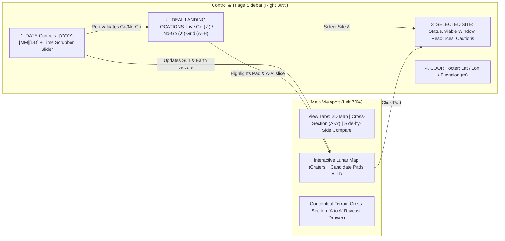
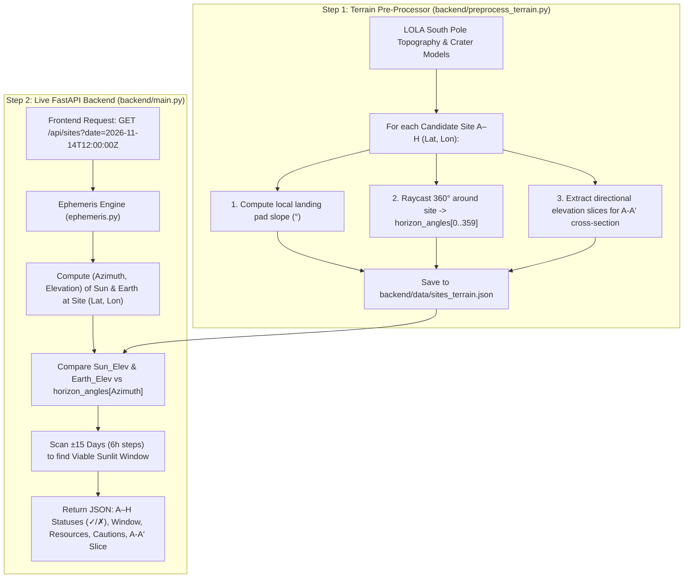

# Lunar Landing Site Navigator — System Architecture

## 1. UI Component Architecture (Mapped from Wireframe Sketch)

### Viewport & Sidebar Breakdown
1. **Main Left Viewport (Map + `A–A'` Cross-Section Concept):**
   * **Top-Down Crater Map:** Displays high-resolution South Pole terrain (LOLA hillshade/slope layer) with candidate landing pads (`A–H` marked with `[⊞]` icons, colored green for `✓` or red for `✗`).
   * **Dynamic Shadow Overlay / Sun Ray Direction:** Shows a visual indicator around the map edge indicating the exact compass direction (`Azimuth`) and angle (`Elevation`) of the Sun and Earth at the chosen date.
   * **2D Terrain Cross-Section (`A — A'`):** Slices the terrain along the Sun's ray passing through the selected landing site, visually showing the Sun ray grazing surrounding crater rims and whether the landing pad sits in sunlight or inside a crater shadow.
2. **Right Sidebar (4 Stacked Modules):**
   * **Module 1 — `DATE` Selector & Scrubber:** Date inputs (`Month / Day / Year`) + a smooth slider (`±30 days`) so planners can scrub forward in time when a launch slips and watch sites flip between `✓` and `✗`.
   * **Module 2 — `IDEAL LANDING LOCATIONS` (`A–H` Triage Matrix):** 2-column grid of candidate sites (`A` through `H`) with live Go (`✓`) / No-Go (`✗`) badges.
   * **Module 3 — `Selected SITE` Inspector:**
     * **Status:** `GO (✓)` / `CAUTION (⚠)` / `NO-GO (✗)`
     * **Window (`Date Range`):** Exact start and end timestamps of continuous sunlight & Earth comms around the selected date.
     * **Available Resources:** Solar illumination %, Direct-to-Earth (DTE) link availability, proximity to Permanently Shadowed Regions (water ice).
     * **Cautions:** Automated warning badges (e.g., *"Crater rim blocks Sun in 48 hrs"*, *"Slope 8.2° near lander limit"*, *"Earth below horizon—relay satellite required"*).
   * **Module 4 — `Coor` Footer:** Exact selenographic coordinates (`Lat, Lon | Elevation (m)`).

---

## 2. Core Parameters & Decision Thresholds

| Category | Parameter | Source / Calculation | Threshold for `✓` (Go) vs `✗` (No-Go) |
| :--- | :--- | :--- | :--- |
| **1. User Inputs** | **Target Date / Time (`T`)** | Date picker & slider (`UTC`) | Drives all ephemeris calculations |
| | **Min Mission Duration** | Default `5 days` (configurable) | Used to check if `Window` is long enough |
| **2. Ephemeris (Time-Dependent)** | **Sun Elevation (`Alt_sun`) & Azimuth (`Az_sun`)** | NASA JPL Ephemeris (`skyfield` / JPL Horizons) | **Sunlit** if `Alt_sun > Horizon_Elev(Az_sun)` |
| | **Earth Elevation (`Alt_earth`) & Azimuth (`Az_earth`)** | NASA JPL Ephemeris (`skyfield` / JPL Horizons) | **DTE Comm Active** if `Alt_earth > Horizon_Elev(Az_earth)` |
| | **Viable Window (`Date Range`)** | Forward/backward time scan around Date `T` | `✓` if continuous sunlit window $\ge$ required mission days |
| **3. Topography (Site-Dependent, Static)** | **360° Horizon Profile (`Horizon_Elev[0..359°]`)** | Raycast from LOLA South Pole DEM around site | Blocks Sun/Earth when terrain angle $>$ celestial elevation |
| | **Local Slope (`°`) & Roughness** | Computed from LOLA DEM grid | `✓` Safe: `< 5°` · `⚠` Caution: `5°–10°` · `✗` Hazard: `> 10°` |
| | **Resource Proximity** | Distance to nearest water-ice PSR crater | Displayed in `Available Resources` |

> **Key Rule for `✓` vs `✗` (`Status`):**
> A site receives **`GO (✓)`** on Date `T` if:
> 1. **Sun is visible above the local crater horizon** (`Alt_sun > Horizon_Elev[Az_sun]`), AND
> 2. **Remaining sunlit window $\ge$ minimum mission threshold** (default `3.0 days`), AND
> 3. **Local slope $< 10^\circ$**.

---

## 3. Backend Architecture & Data Pipeline

### 3.1 Where the Data Comes From
1. **Ephemeris Data (Dynamic — Sun & Earth Positions):**
   * **NASA NAIF / JPL Development Ephemeris (`de421.bsp`)** evaluated via Python **`skyfield`**, plus live fallback/validation query support for **NASA JPL Horizons REST API** (`https://ssd.jpl.nasa.gov/api/horizons.api`).
   * Computes exact selenographic observer `Azimuth (0°–360°)` and `Elevation (-90° to +90°)` of the Sun and Earth from any Lunar `(lat, lon, elevation_m)` at any UTC timestamp.
2. **Topographic & Terrain Data (Static — LOLA South Pole DEM):**
   * Based on **NASA LRO LOLA (Lunar Orbiter Laser Altimeter)** South Pole elevation data (`80°S–90°S`) and official **Artemis III / CLPS candidate landing sites** (`A` through `H`: *Shackleton Rim, Malapert Massif, de Gerlache Rim, Leibnitz Beta, Haworth Rim, Nobile Rim 1, Faustini Rim, Cabeus Peak*).
   * Pre-computed into `backend/data/sites_terrain.json` containing each site's 360° horizon elevation mask (`horizon_angles[0..359]`), directional `A–A'` terrain cross-section profiles, slope, elevation, and resource metadata.

### 3.2 Query & Processing Flow

### 3.3 Backend Processing Logic (Per Request)
1. **Compute Celestial Angles:** Given `date` (ISO-8601 UTC) and Site `(lat, lon, elev_m)`, compute:
   * `sun_az`, `sun_alt` (degrees)
   * `earth_az`, `earth_alt` (degrees)
2. **Horizon Occlusion Check:**
   * Look up terrain obstruction angle along the Sun's compass direction: `terrain_sun_horizon = horizon_angles[round(sun_az) % 360]`
   * `sun_margin_deg = sun_alt - terrain_sun_horizon` (`> 0` means **Sunlit**)
   * Look up terrain obstruction angle along Earth's compass direction: `terrain_earth_horizon = horizon_angles[round(earth_az) % 360]`
   * `earth_margin_deg = earth_alt - terrain_earth_horizon` (`> 0` means **Direct-to-Earth Comm Active**)
3. **Viable Window Scan (`window`):**
   * Step backward and forward around `date` across a 30-day window (`±15 days` at 6-hour resolution) to calculate exact start date, end date, total sunlit percentage, and remaining continuous sunlit days.
4. **Extract `A–A'` Cross-Section (`cross_section`):**
   * Slice the terrain along the active `sun_az` azimuth axis (`-10 km` to `+10 km` across the landing site) so the frontend can plot the exact terrain wave (`A` to `A'`) and overlay the incoming Sun ray at angle `sun_alt`.

---

## 4. Backend REST API Specification (FastAPI)

Base URL: `http://localhost:8000` (Interactive docs at `http://localhost:8000/docs`)

### `GET /api/sites`
Evaluates all candidate sites (`A–H`) for a given timestamp (powers the Map & `IDEAL LANDING LOCATIONS` grid).
* **Query Params:**
  * `date` (optional, default: current UTC ISO string, e.g., `2026-11-14T12:00:00Z`)
  * `min_duration_days` (optional, default: `3.0`)
* **Response (`200 OK`):**
  * Timestamp, global South Pole Sun direction, and array of sites `A–H` with `status` (`GO`, `CAUTION`, `NO_GO`), `is_go` (`true`/`false`), `sun_elevation`, `earth_elevation`, `is_sunlit`, `has_earth_comm`, and `coordinates`.

### `GET /api/sites/{site_id}`
Returns full details for a single selected site (powers the `Selected SITE` card, `Coor` footer, and `A–A'` terrain cross-section).
* **Path Params:** `site_id` (`A` through `H`)
* **Query Params:** `date` (`YYYY-MM-DDTHH:MM:SSZ`)
* **Response (`200 OK`):**
  * Full site status, `window` (`start`, `end`, `remaining_days`, `sunlit_pct_30d`, `timeline_6h`), `resources` list, `cautions` list, `horizon_profile_360`, and `cross_section_aa` (distances in km, elevations in meters, sun ray line coordinates).

### `GET /api/compare`
Compares two scenarios side-by-side (either two different sites on the same date, or the same site on two different dates).
* **Query Params:** `site_a`, `date_a`, `site_b`, `date_b`
* **Response (`200 OK`):** Side-by-side evaluation payloads + automated comparison summary (`recommended_scenario`, `key_differences`).

### `GET /api/horizons-validate`
Queries NASA's live **JPL Horizons API** (`ssd.jpl.nasa.gov/api/horizons.api`) for a given site and date to cross-validate the local ephemeris engine against live NASA servers.
